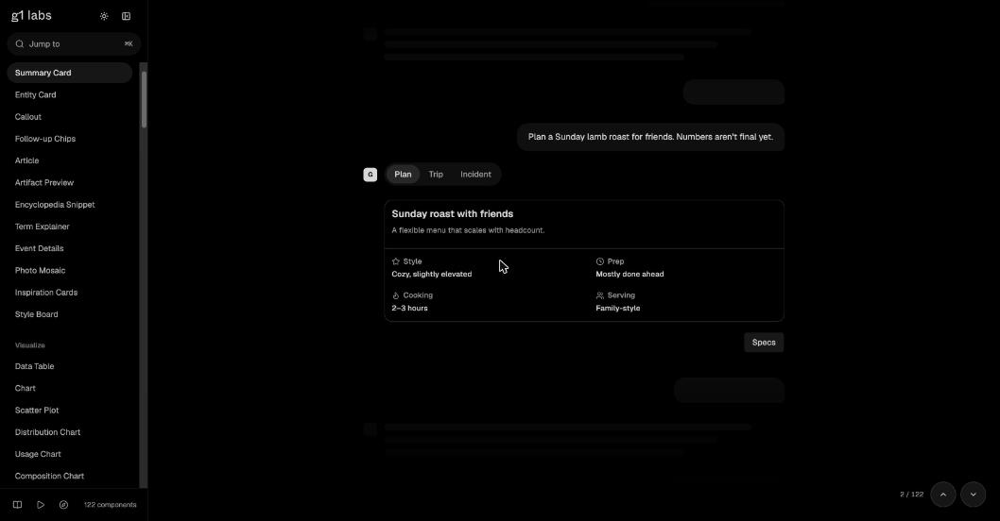
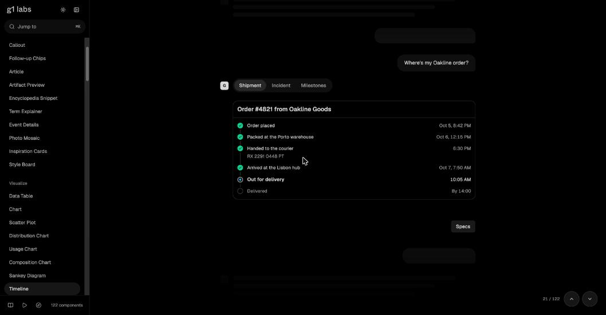
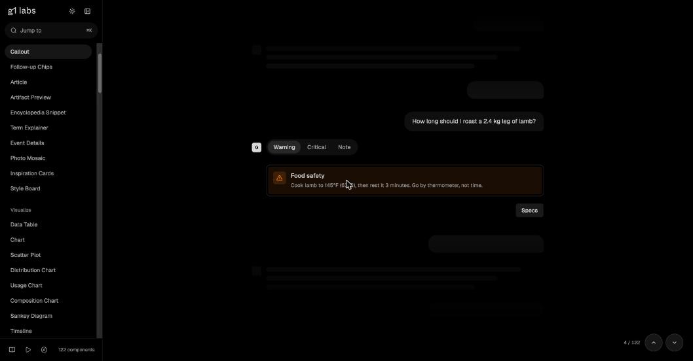
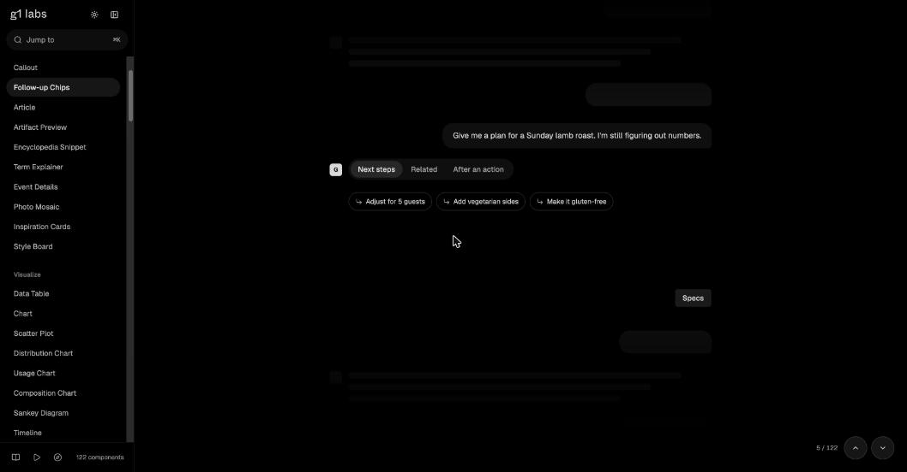
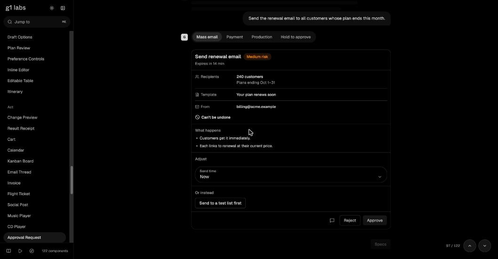
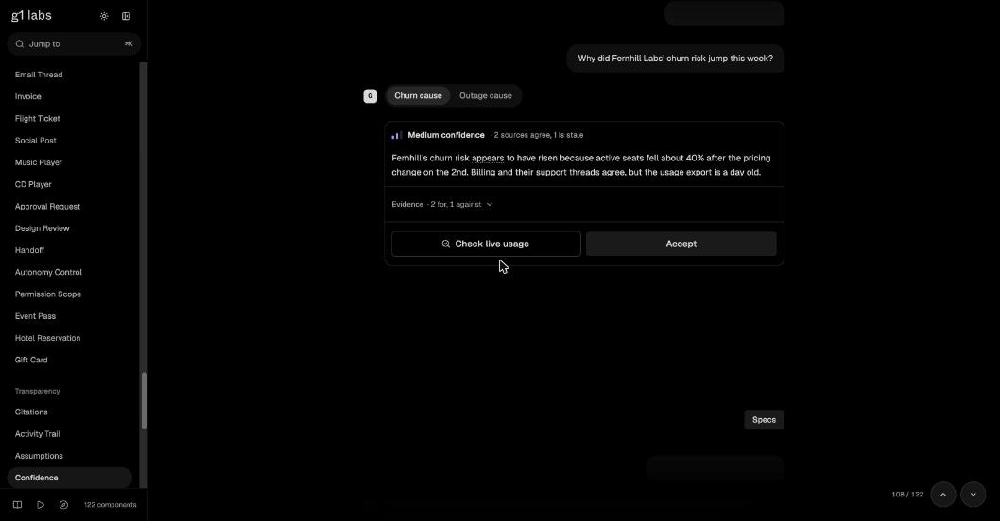
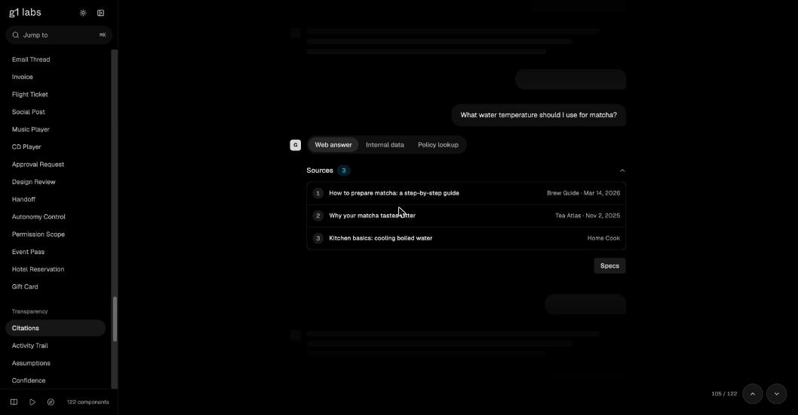
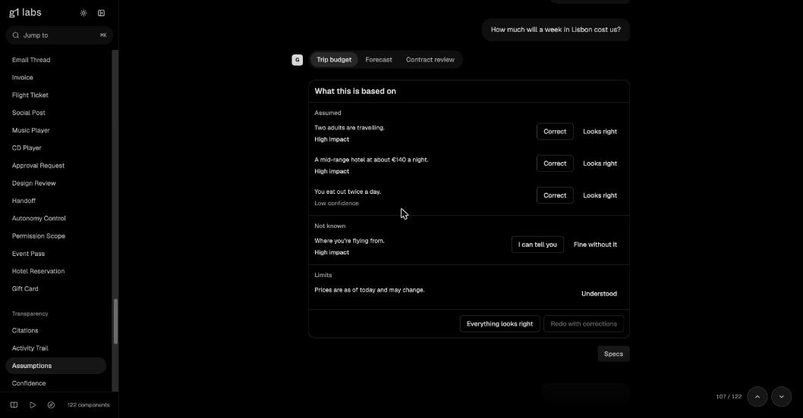
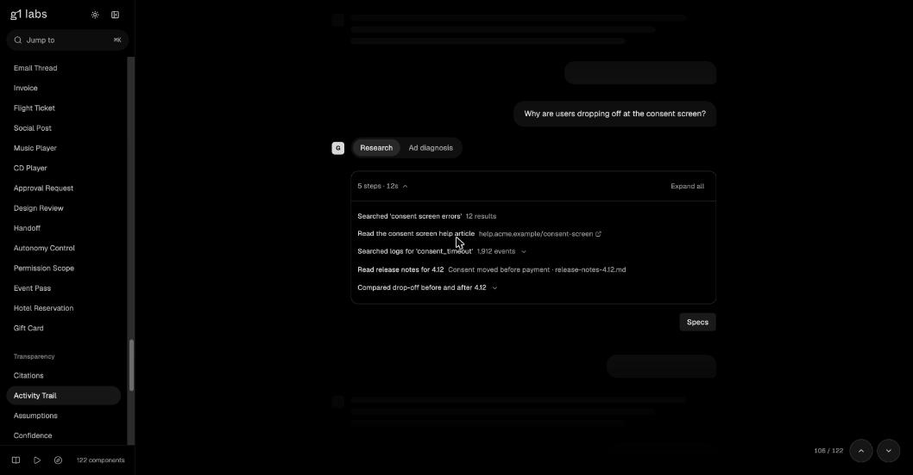

# g1-labs — Generative UI Components Reference
> קומפוננטות רלוונטיות למסך Incident Investigation
> מקור: https://g1-labs.dev · 122 קומפוננטות סה"כ

---

## עקרונות הספרייה (Principles)

1. **Show UI only when interaction is needed** — שאלה מגיעה עם תשובה, לא עם ווידג'ט. UI מיוצר רק כשיש interaction שלא אפשרי בטקסט רגיל.
2. **Data-bound, not guessed** — שדות מסומנים DATA-BOUND חייבים לבוא מ-tool result. האי לא ממציא IDs, ערכים, או מחירים.
3. **Transparency before action** — כל פעולה שכותבת למערכת חיצונית עוברת דרך קומפוננטה שמציגה בדיוק מה ישתנה לפני ביצוע. פעולות בלתי הפיכות מסומנות מפורש.
4. **Closed actions** — קומפוננטות מחזירות typed result עם סט קבוע של actions (confirm / reject). האי לא מחווט מה כפתור עושה.
5. **Streamable** — כל קומפוננטה מרנדרת גם מ-partial props בזמן streaming, ומנטרלת actions עד שה-payload מלא.

---

## Tier 1 — חובה במסך Investigation

---

### 1. Summary Card

**קטגוריה:** Compose
**תיאור:** "A plan or overview at a glance"
**מתי להשתמש:** כשה-AI מסכם תכנית, ממצא, או מצב שמורכב מכמה ממדים. עדיף על טקסט כשיש כמה פרמטרים מובנים עם ערכים.
**מתי לא:** לעובדות בודדות פשוטות — טקסט מספיק.

**מבנה ויזואלי:**
- כותרת ראשית + כותרת משנה (תיאור קצר)
- tabs לעבור בין contexts (Plan / Trip / Incident)
- רשת של זוגות Label / Value (2 עמודות, icon + label + value bold)
- כפתור Specs בפינה

**שימוש שלנו:** כרטיס Threat Summary — שם האינסידנט + narrative + stats grid (Style=Severity / Prep=Duration / Cooking=Alerts / Serving=Hosts).

---

### 2. Timeline

**קטגוריה:** Visualize
**תיאור:** "Ordered events with their state"
**מתי להשתמש:** סדרת אירועים עם state לכל אחד.

**מבנה ויזואלי:**
- רשימה ורטיקלית, connecting line בין dots
- כל item: **dot צבעוני** (ירוק=done, כחול/כתום=active, אפור ריק=pending) + **timestamp** ימין + **כותרת** + **פרטים** בשורה שנייה
- item פעיל = bold, item עתידי = מעומעם
- tabs לעבור בין scenarios (Shipment / Incident / Milestones)

**states:** ✓ ירוק מלא = done / ⟳ כחול = active/current / ○ אפור = pending

**שימוש שלנו:** Attack timeline — 4 מתוך 23 אירועים. dots אדומים לאירועי attack, צהוב לאירוע חשוד ראשוני. אירועים עם ביטחון נמוך — ⚠ badge נוסף.

---

### 3. Callout

**קטגוריה:** Compose
**תיאור:** "The one notice the user must not miss"
**מתי להשתמש:** הודעה אחת קריטית. לא יותר מ-callout אחד בתשובה.
**מתי לא:** אל תשתמש בכמה callouts — ה-impact נעלם.

**3 variants** (tabs: Warning / Critical / Note):
- **Warning** (צהוב/כתום) — border שמאלי צהוב, background צהוב עדין, אייקון ⚠
- **Critical** (אדום) — border אדום, רקע אדום עדין
- **Note** (ניטרלי) — רקע אפור עדין

**מבנה ויזואלי:**
- שורה אחת: אייקון + **כותרת bold** + משפט פירוט

**שימוש שלנו:**
- Warning: "Cannot confirm: data exfiltration — no egress signals detected"
- Critical: כשהאינסידנט עדיין פעיל עם ransomware

---

### 4. Follow-up Chips

**קטגוריה:** Compose
**תיאור:** "One-tap next steps after an answer"
**מתי להשתמש:** אחרי תשובה — 2–4 שאלות המשך טבעיות שהמשתמש כנראה ירצה לשאול.
**מתי לא:** אל תציע chips שלא רלוונטיות ישירות לתשובה.

**3 variant tabs:**
- **Next steps** — מה לעשות אחר כך
- **Related** — מידע קשור
- **After an action** — לאחר ביצוע פעולה

**מבנה ויזואלי:**
- שורה אחת של pill buttons עם חץ קטן ↳ משמאל
- 2–4 chips, טקסט קצר (3–5 מילים), background כהה, border עדין

**שימוש שלנו:** מתחת ל-chat box: `↳ Who is john.doe?` / `↳ Similar past incidents` / `↳ Full alert list`

---

### 5. Approval Request

**קטגוריה:** Act
**תיאור:** "Permission for one action, with scope and consequences"
**מתי להשתמש:** כל פעולה שה-AI עומד לבצע במערכת חיצונית. כל פעולה = approval request נפרד.
**מתי לא:** אל תקבץ כמה פעולות ל-approval אחד.

**מבנה ויזואלי (מלמעלה למטה):**
1. **כותרת** + **risk badge** צבעוני (Low/Medium/High risk) + expiry timer אופציונלי
2. **שדות scope** (data-bound): Recipients / Template / From — Label ימין, Value שמאל
3. שורת **"Can't be undone"** — אייקון ⏱ + טקסט אדום/אפור
4. **"What happens"** — bullet points של תוצאות ספציפיות
5. **"Adjust"** section — dropdown / input לשינוי פרמטר לפני אישור
6. **"Or instead"** — כפתור פעולה חלופית פחות אגרסיבית
7. Footer: כפתור feedback (📋) + **Reject** (outline) + **Approve** (filled)

**שימוש שלנו:** כל response action (Isolate / Reset credentials / Block hash). הוספנו collapsible Details — פתוח כברירת מחדל לפעולה הראשונה.

---

### 6. Confidence

**קטגוריה:** Transparency
**תיאור:** "How sure the agent is, with evidence for and against"
**מתי להשתמש:** ניתוח שמתבסס על מספר מקורות ולא כולם מסכימים, או uncertainty מהותי.

**מבנה ויזואלי:**
- Header: אייקון מד + **"Medium confidence"** (או High/Low) + "· N sources agree, N is stale"
- פסקה: הסבר מה האי הסיק ומדוע — משפט-שניים
- **"Evidence · N for, N against"** — שורה עם toggle ▾ לפתיחת רשימה
- 2 כפתורים: **"Check [live source]"** (outline, icon) + **"Accept"** (filled)

**שימוש שלנו:** Confidence 94% עם 3 sources confirmed + 1 stale. העדויות: WildFire match / mimikatz pattern / impossible travel / RDP (1 signal only — uncertain).

---

### 7. Citations

**קטגוריה:** Transparency
**תיאור:** "Claims linked to their sources"
**מתי להשתמש:** כשה-AI עושה טענות שמתבססות על מקורות ספציפיים שאפשר לאמת.

**מבנה ויזואלי:**
- header: **"Sources"** + badge עם מספר (3)
- chevron ▴ לכיווץ
- רשימה ממוספרת, כל שורה: **[מספר]** + **כותרת מקור** + **[שם מקור · תאריך]** מיושר ימין
- tabs לעבור בין contexts (Web answer / Internal data / Policy lookup)

**שימוש שלנו:** מקור לכל event בטיימליין: "Identity logs · Cortex XDR" / "Endpoint agent · process tree" / "WildFire DB · confirmed malicious".

---

### 8. Assumptions

**קטגוריה:** Transparency
**תיאור:** "What the answer assumes, and corrections"
**מתי להשתמש:** כשה-AI עשה הנחות שעשויות להיות שגויות — נותן למשתמש לתקן.

**מבנה ויזואלי (מלמעלה למטה):**
1. **כותרת: "What this is based on"**
2. **Section "Assumed"** — כל הנחה: טקסט + badge (High/Low impact) + כפתורי "Correct" / "Looks right"
3. **Section "Not known"** — מה לא ידוע + impact + כפתורי "I can tell you" / "Fine without it"
4. **Section "Limits"** — מגבלות של הנתונים (כמו "Prices are as of today") + כפתור "Understood"
5. Footer: **"Everything looks right"** + **"Redo with corrections"**

**שימוש שלנו:**
- Assumed: "john.doe is the only compromised account · High impact"
- Not known: "Whether data was exfiltrated · High impact → I can tell you / Fine without it"
- Limits: "Network logs have 5-min delay — recent events may be incomplete"

---

### 9. Activity Trail

**קטגוריה:** Transparency
**תיאור:** "The searches and tool calls behind an answer"
**מתי להשתמש:** כשה-AI ביצע כמה שלבי חקירה והמשתמש עשוי לרצות לראות את העבודה.

**מבנה ויזואלי:**
- Header: **"N steps · Xs"** + chevron לכיווץ + **"Expand all"** ימין
- רשימת שלבים בשורה אחת כל אחד:
  - **"Searched '[query]'"** · N results
  - **"Read [file/URL]"** — link חיצוני
  - **"Searched logs for '[field]'"** · N events + chevron לפרטים
  - **"Compared X before and after Y"** + chevron לפרטים
- כל שלב ניתן להרחבה

**שימוש שלנו:** כשאנליסט לוחץ "How did you investigate?": "Analyzed 23 alerts", "Queried WildFire for hash a3f9c2b1", "Cross-referenced Identity logs for john.doe", "Matched MITRE ATT&CK patterns against endpoint events".

---

## מיפוי מלא: חלקי המסך → קומפוננטות

| חלק במסך | קומפוננטה ראשית | קומפוננטה משלימה |
|---|---|---|
| Threat narrative + stats | Summary Card | — |
| "Cannot confirm" box | Callout (Warning) | Assumptions ("Not known") |
| Confidence % + sources | Confidence | Citations |
| Attack timeline | Timeline | Citations (per event) |
| Response actions | Approval Request × 3 | — |
| Chat input | — | — |
| Suggested questions | Follow-up Chips | — |
| "How did you investigate?" | Activity Trail | — |
| "Full alert list" | Data Table | — |
| Loading state | Streaming Skeleton | Execution Progress |
